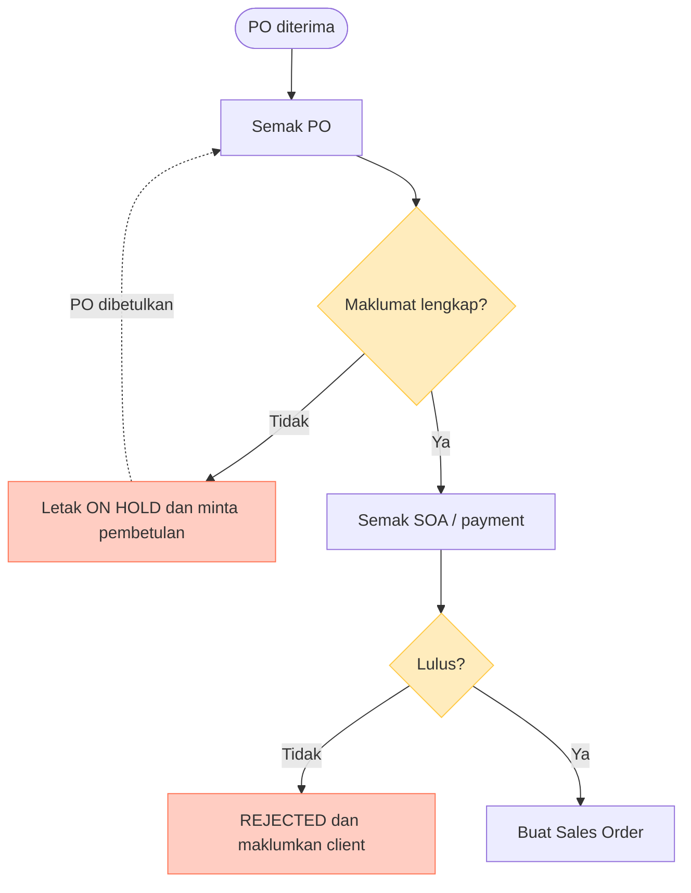
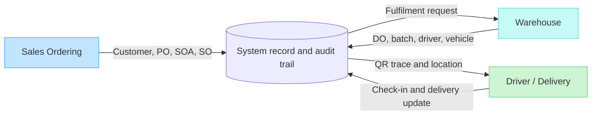
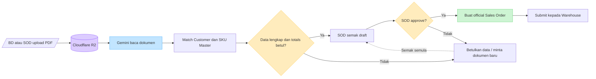

# Sales Ordering - Flowchart Untuk Team SOD

Dokumen ini ialah versi ringkas untuk presentation. Prinsip paling penting:

> Sales Ordering mengurus customer, PO, SOA, Sales Order dan laporan. Warehouse mengurus batch, DO, driver dan penghantaran. Sales Order tidak menolak stok.

## 1. Flow utama: PO hingga delivered

```mermaid
flowchart LR
    start([Customer PO / Order])

    subgraph salesTeam ["Sales Ordering"]
        receive[Terima PO]
        customer[Semak Customer Master]
        review[Analisis SKU, qty dan tarikh]
        soa{SOA / payment lulus?}
        createSo[Buat Sales Order]
        submit[Submit kepada Warehouse]
    end

    subgraph warehouseTeam ["Warehouse"]
        queue[Terima fulfilment request]
        createDo[Buat DO dan pilih batch]
        dispatch[Dispatch dengan driver dan kenderaan]
        checkin[Location Check-In]
        delivered([Delivered])
    end

    start --> receive
    receive --> customer
    customer --> review
    review --> soa
    soa -->|"Lulus"| createSo
    createSo --> submit
    submit --> queue
    queue --> createDo
    createDo --> dispatch
    dispatch --> checkin
    checkin --> delivered

    style soa fill:#FFECBD,stroke:#FFC943
    style createSo fill:#C2E5FF,stroke:#3DADFF
    style createDo fill:#C6FAF6,stroke:#5AD8CC
    style delivered fill:#CDF4D3,stroke:#66D575
```



## 2. Jika SOA atau maklumat PO bermasalah



## 3. Siapa buat apa?



## 4. Contoh satu order

```text
Customer: AEON CO. (M) BHD
Customer ID: 3000/838
Customer PO: 80104000925726
Sales Order / Proforma: S0019476
Payment term: 60 DAYS
Delivery address: Lot 3, Jalan 6C/12, Bandar Baru Bangi

Sales masukkan 3 item dan 81 carton.
Sales Order diluluskan.
Warehouse kemudian pilih batch dan cipta DO.
DO direkodkan dengan driver, kenderaan dan destination.
Driver buat Location Check-In.
Sales boleh trace status delivery melalui DO.
```

## 5. Ayat paling mudah untuk presentation

```text
Sales Ordering jawab: "Apa customer order dan bolehkah order itu diproses?"
Warehouse jawab: "Batch mana yang dikeluarkan dan bagaimana ia dihantar?"
System jawab: "Apa sejarah order dari PO sampai delivered?"
```

## 6. Perkara yang sistem tidak ubah

- Production tetap bekerja seperti biasa.
- Sales Order tidak mengurangkan inventory.
- Warehouse masih memilih batch dan mencipta DO.
- QR batch dan Location Check-In kekal di bawah Warehouse traceability.
- DO kekal sebagai rekod rasmi untuk stock-out dan delivery.

## 7. Flow tambahan: AI Invoice Intake



### Rule AI yang wajib difahami

```text
AI membaca dan mencadangkan data.
SOD menyemak dan approve.
System create SO selepas approve.
Warehouse create DO dan pilih batch.
```

AI tidak boleh terus create DO atau mengurangkan stok.
